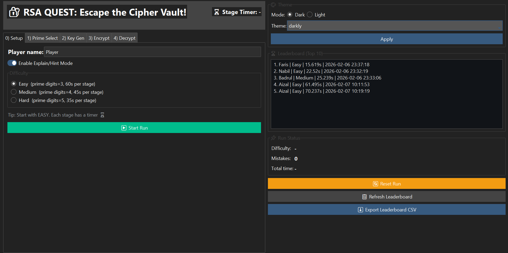
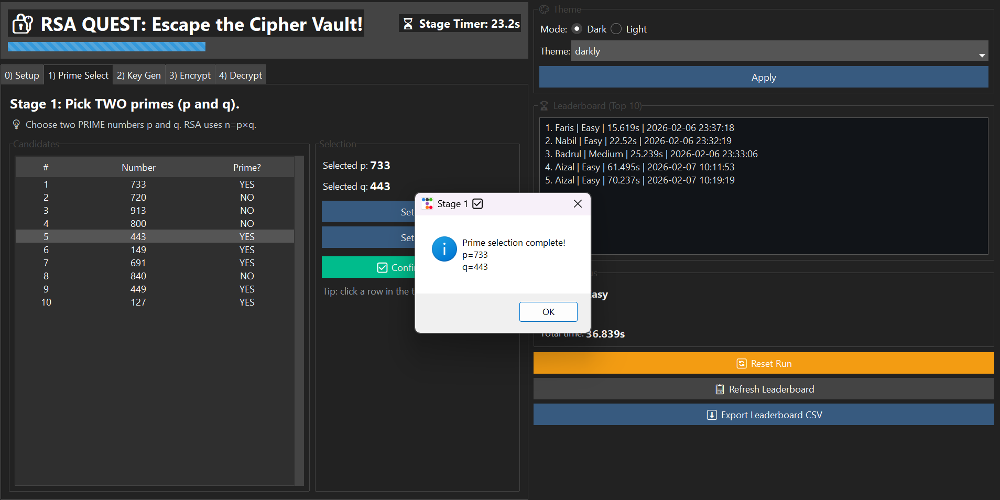
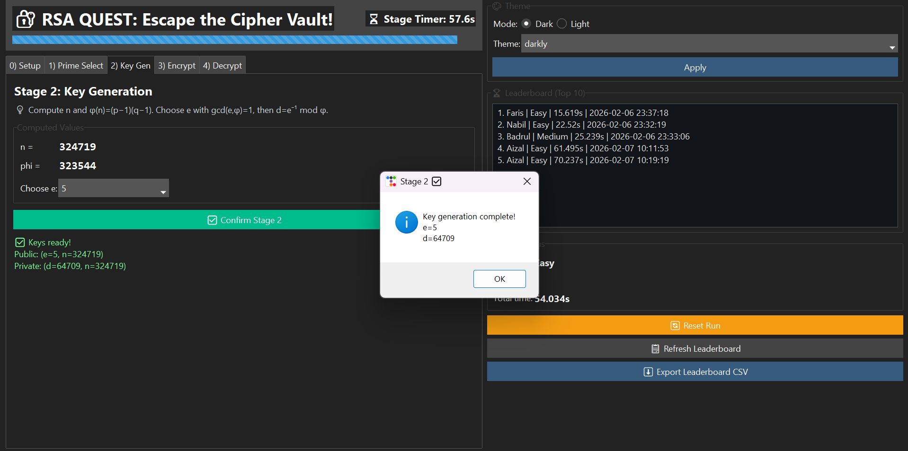
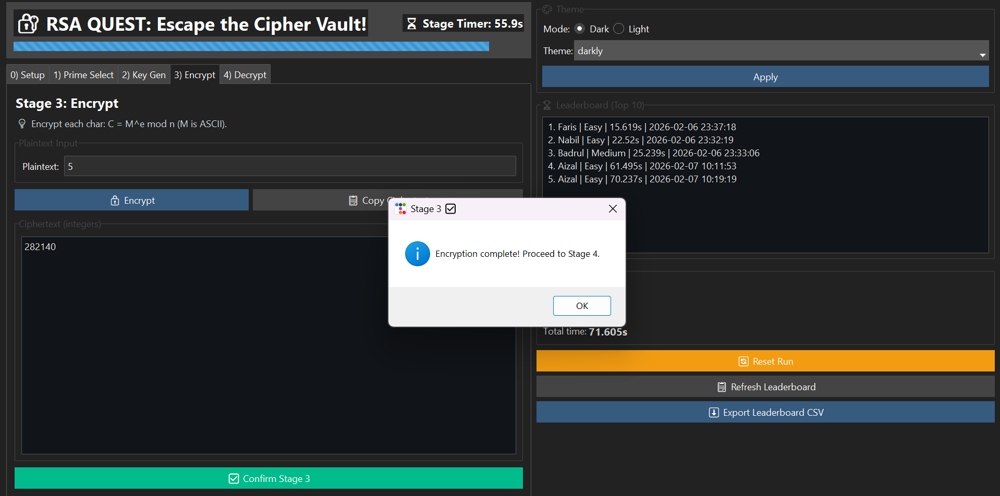
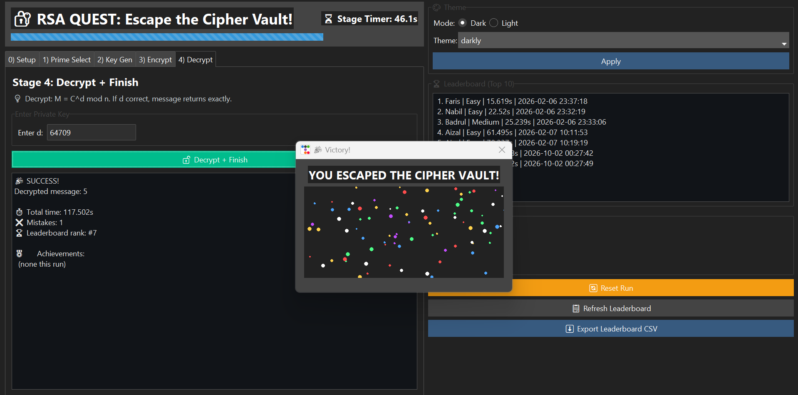

# 🔐 RSA Quest: Escape the Cipher Vault

RSA Quest is an interactive educational game designed to demonstrate the fundamental concepts of the **RSA public-key cryptographic algorithm** through a step-by-step graphical interface.

This project was developed as an **Academic Group Project** for **CSC669 – Cryptographic Algorithms**.

## 📌 Project Overview

Cryptographic algorithms can be difficult to understand when learned only through mathematical theory. RSA Quest turns the RSA process into an interactive challenge where users progress through the main stages of RSA:

1. Prime Number Selection
2. RSA Key Generation
3. Message Encryption
4. Message Decryption

Players must successfully complete each stage within a time limit to escape the "Cipher Vault".

## ✨ Features

- 🔢 Interactive prime number selection
- 🔑 RSA public and private key generation
- 🔒 Message encryption
- 🔓 Message decryption
- 💡 Explain/Hint Mode
- ⏱️ Stage-based timer
- 🎚️ Easy, Medium, and Hard difficulty levels
- 🏆 Leaderboard system
- 🎖️ Achievement system
- 🌙 Dark and Light themes
- 📊 Leaderboard CSV export
- 🎉 Victory animation

## 🖥️ Screenshots

### Setup


### Stage 1 — Prime Number Selection


### Stage 2 — Key Generation


### Stage 3 — Encryption


### Stage 4 — Decryption & Victory


## 🔐 How RSA Quest Works

The game demonstrates the basic RSA process:

### 1. Select Prime Numbers

The player selects two different prime numbers:

`p` and `q`

The modulus is calculated as:

`n = p × q`

### 2. Generate RSA Keys

Euler's totient is calculated using:

`φ(n) = (p - 1)(q - 1)`

The player selects a public exponent `e` where:

`gcd(e, φ(n)) = 1`

The private exponent `d` is then calculated as the modular inverse:

`d = e⁻¹ mod φ(n)`

The resulting keys are:

- Public Key: `(e, n)`
- Private Key: `(d, n)`

### 3. Encrypt Message

Each character of the plaintext is converted to its character code and encrypted using:

`C = M^e mod n`

### 4. Decrypt Message

The ciphertext is decrypted using the private key:

`M = C^d mod n`

If the decrypted message matches the original plaintext, the player successfully escapes the Cipher Vault.

## 🛠️ Technologies Used

- Python
- Tkinter
- ttkbootstrap
- RSA Cryptography
- Modular Arithmetic
- Miller–Rabin Primality Testing
- JSON
- CSV

## 📁 Project Structure

```text
RSA QUEST/
├── src/
│   ├── rsa_game.py
│   └── rsa_game_gui.py
├── screenshots/
│   ├── setup.png
│   ├── prime_selection.png
│   ├── key_generation.png
│   ├── encryption.png
│   └── decryption_victory.png
├── data/
├── .gitignore
├── README.md
└── requirements.txt
```

## 🚀 How to Run

### 1. Clone the repository

```bash
git clone <repository-url>
cd <repository-folder>
```

### 2. Install dependencies

```bash
pip install -r requirements.txt
```

### 3. Run RSA Quest

```bash
python src/rsa_game_gui.py
```

## ⚠️ Educational Purpose

This application is designed for **educational purposes** to demonstrate the fundamental mathematics and workflow behind RSA.

It uses small prime numbers and simplified textbook-style RSA operations to make the algorithm easier to visualize. Therefore, this implementation **should not be used for real-world cryptographic security**.

## 👥 Project Type

**Academic Group Project**  
CSC669 – Cryptographic Algorithms

## 🎯 Learning Outcomes

Through this project, we explored:

- RSA key generation
- Prime number generation and primality testing
- Modular arithmetic and modular inverses
- Public-key encryption and decryption
- GUI development with Python
- Gamification of cryptographic concepts